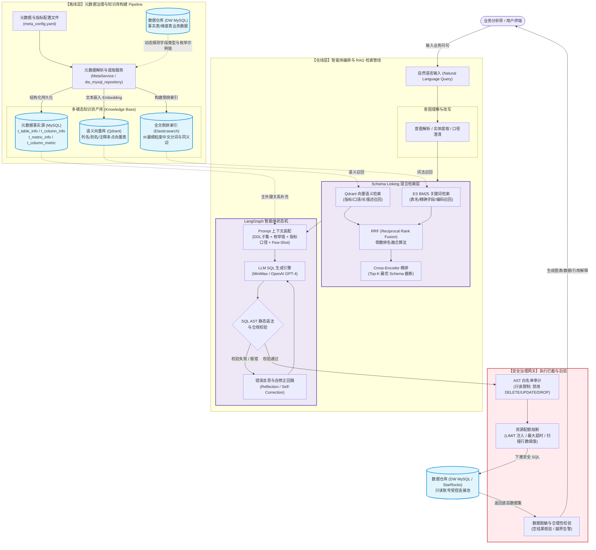
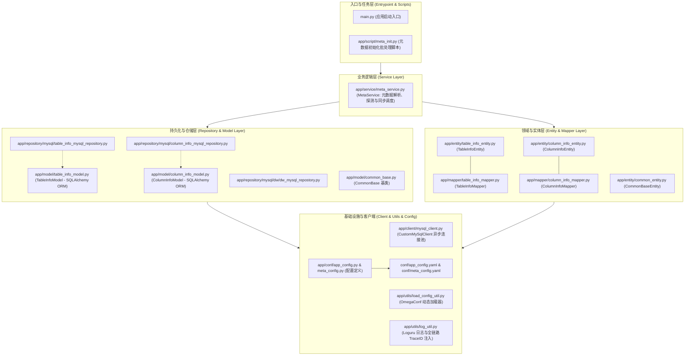
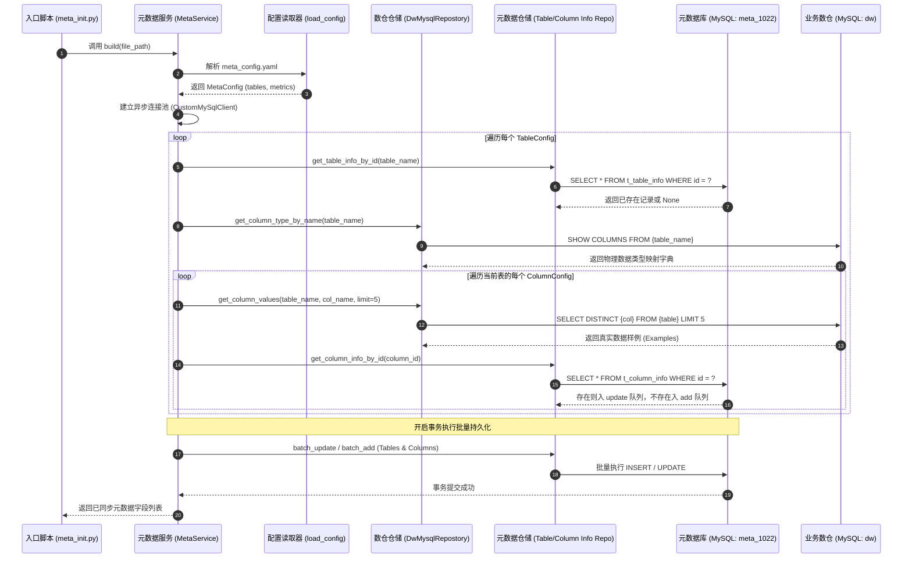
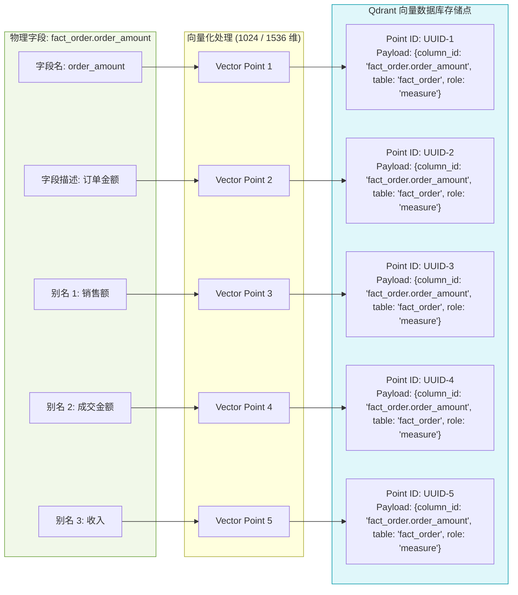
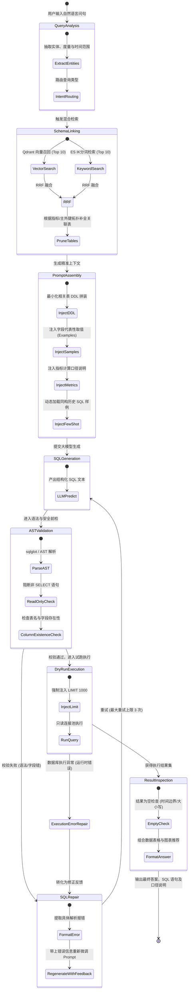
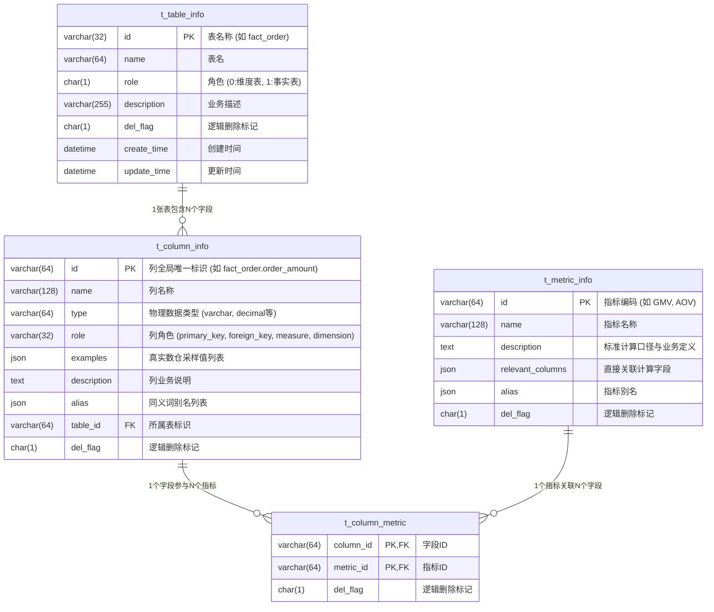
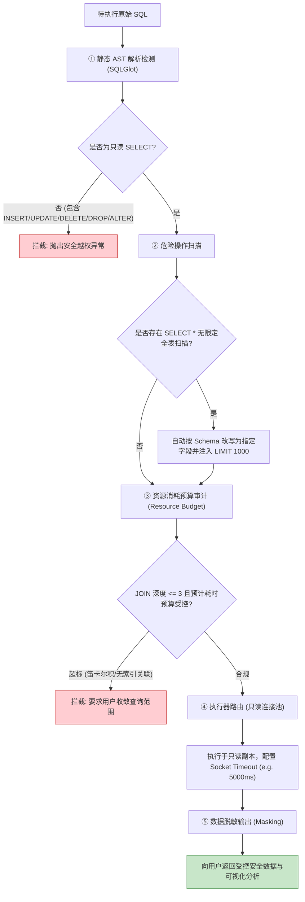
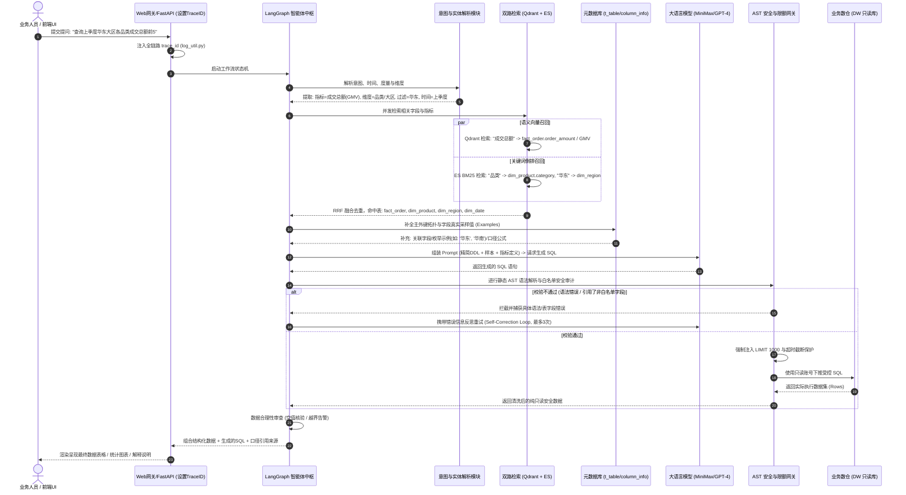
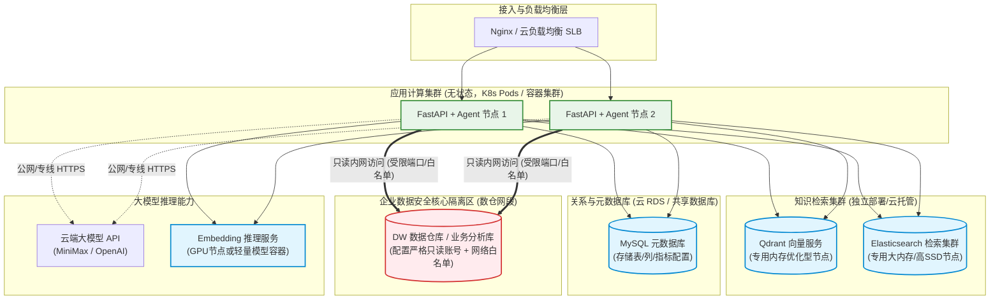

# Text2SQL1021 系统架构设计与解析文档

> 本文档针对 **Text2SQL1021** 项目进行系统性技术解析，使用 Mermaid 绘制完整的系统总体架构、代码工程分层、离线元数据沉淀、在线双路检索与智能体（Agent）状态流向图，并结合现有代码实现与演进规划进行详尽阐述。

---

## 1. 项目定位与核心设计理念

### 1.1 业务背景与解决痛点

在传统企业数据取数场景中，业务分析人员需要通过提工单、等待数据团队排期、反复沟通口径、编写 SQL、核对结果的漫长流程（通常以天为单位）。本项目旨在通过大语言模型（LLM）将自然语言问题（NL）自动化转写为**精准、安全、高性能、可解释**的 SQL 查询语句，实现“秒级自助取数”。

### 1.2 核心设计哲学：RAG + 知识库 + 智能体反思

传统的直接 Prompt 方式将整个数据库所有 Schema（DDL）灌给模型，在真实企业环境中存在以下致命缺陷：

1. **Token 限制与高昂成本**：大型数仓成百上千张表、上万字段，一次性输入超出上下文窗口且显著拉长首字响应时间（TTFT）。
2. **Schema 干扰与近义歧义**：无关表的相似字段（如 `pay_amount` vs `order_amount`、`create_time` vs `pay_time`）极易导致模型产生幻觉，发生 Schema Linking 错误。
3. **缺少动态统计特性与口径约束**：仅凭 DDL 无法获知字段枚举值、离散示例、外键连接路径及特定业务指标（如 GMV、AOV）的标准统计口径。

本项目采用 **“离线知识沉淀 + 在线双路混合检索（Schema Linking）+ LangGraph 循环自反思智能体 + 安全网关”** 的整体架构体系。

---

## 2. 总体系统架构图 (Overall System Architecture)

以下为系统的端到端总体架构，涵盖离线知识库构建体系、在线服务与编排层、检索层及执行安全网关：

---

## 3. 代码工程分层与组件映射 (Component & DDD Layering)

本项目采用严格分层架构（清晰解耦数据实体、领域业务模型与基础设施接入），对应代码工程目录如下：

### 各层级职责速查表

| 层级名称                      | 对应目录                    | 核心类/文件                                                                                                                                                                                                                                                                                                                                                                                                        | 核心职责                                                                 |
| ----------------------------- | --------------------------- | ------------------------------------------------------------------------------------------------------------------------------------------------------------------------------------------------------------------------------------------------------------------------------------------------------------------------------------------------------------------------------------------------------------------ | ------------------------------------------------------------------------ |
| **配置层 (Config)**           | `conf/`, `app/conf/`        | [app_config.py](file:///c:/Users/admin/PycharmProjects/Text2SQL1021/app/conf/app_config.py), [meta_config.py](file:///c:/Users/admin/PycharmProjects/Text2SQL1021/app/conf/meta_config.py)                                                                                                                                                                                                                         | 强类型数据类校验系统级与元数据级 YAML 配置                               |
| **客户端层 (Client)**         | `app/client/`               | [mysql_client.py](file:///c:/Users/admin/PycharmProjects/Text2SQL1021/app/client/mysql_client.py)                                                                                                                                                                                                                                                                                                                  | 基于 `asyncmy` + `SQLAlchemy` 异步引擎会话工厂管理                       |
| **仓储层 (Repository)**       | `app/repository/`           | [table_info_mysql_repository.py](file:///c:/Users/admin/PycharmProjects/Text2SQL1021/app/repository/mysql/table_info_mysql_repository.py), [column_info_mysql_repository.py](file:///c:/Users/admin/PycharmProjects/Text2SQL1021/app/repository/mysql/column_info_mysql_repository.py), [dw_mysql_repostory.py](file:///c:/Users/admin/PycharmProjects/Text2SQL1021/app/repository/mysql/dw/dw_mysql_repostory.py) | 封装数据库 CRUD 操作、底层 DDL 反射及去重采样能力                        |
| **领域对象层 (Entity/Model)** | `app/entity/`, `app/model/` | [table_info_entity.py](file:///c:/Users/admin/PycharmProjects/Text2SQL1021/app/entity/table_info_entity.py), [column_info_entity.py](file:///c:/Users/admin/PycharmProjects/Text2SQL1021/app/entity/column_info_entity.py), [column_info_model.py](file:///c:/Users/admin/PycharmProjects/Text2SQL1021/app/model/column_info_model.py)                                                                             | 区分业务 Domain Entity 与数据库映射 ORM Model                            |
| **实体转换层 (Mapper)**       | `app/mapper/`               | [table_info_mapper.py](file:///c:/Users/admin/PycharmProjects/Text2SQL1021/app/mapper/table_info_mapper.py), [column_info_mapper.py](file:///c:/Users/admin/PycharmProjects/Text2SQL1021/app/mapper/column_info_mapper.py)                                                                                                                                                                                         | 保证业务层代码不直接耦合底层 ORM 框架特性                                |
| **服务层 (Service)**          | `app/service/`              | [meta_service.py](file:///c:/Users/admin/PycharmProjects/Text2SQL1021/app/service/meta_service.py)                                                                                                                                                                                                                                                                                                                 | 业务编排：加载配置、反查数仓字段类型、探查示例数据、执行 Upsert 批量入库 |
| **工具层 (Utils)**            | `app/utils/`                | [log_util.py](file:///c:/Users/admin/PycharmProjects/Text2SQL1021/app/utils/log_util.py), [load_config_util.py](file:///c:/Users/admin/PycharmProjects/Text2SQL1021/app/utils/load_config_util.py)                                                                                                                                                                                                                 | 异步 TraceID 注入、日志轮转与压缩、OmegaConf 模式反序列化                |

---

## 4. 离线元数据沉淀与同步时序图 (Offline Ingestion Pipeline)

系统通过 [meta_init.py](file:///c:/Users/admin/PycharmProjects/Text2SQL1021/app/script/meta_init.py) 执行离线知识库构建，完整流程如下图所示：

---

## 5. 多数据点语义向量设计 (Multi-Point Vector Indexing)

在 [README.md](file:///c:/Users/admin/PycharmProjects/Text2SQL1021/README.md) 中提出的“多数据点”（Multi-Point）向量存储设计是解决中文自然语言同义词和多维度召回的关键：

> **设计要点**：
>
> - 为什么不用 `column_id` 做 Point ID？因为一个字段对应多个向量点（名称、描述、N 个别名），若共用 ID 会相互覆盖，因此使用独立的 UUID 作为向量点主键。
> - Payload 均统一挂载完整的 `column_id`，召回时按 `column_id` 进行去重（Deduplication），保证在命中任一别名时都能准确拉出物理字段及宿主表信息。

---

## 6. 在线智能体工作流与反思状态图 (LangGraph State Graph)

在线生成采用 LangGraph 状态图模型构建反思修正循环，确保在生成 SQL 语法错误、执行超限或字段缺失时能够自我纠偏：

---

## 7. 元数据数据库 ER 实体关系图 (Metadata Database Schema)

底层元数据库设计保证了**表、列、指标、关系**四个维度的完整追踪（依据 [initmysql](file:///c:/Users/admin/PycharmProjects/Text2SQL1021/mysql/initmysql) 及 Model 实现）：

---

## 8. 安全治理与执行防护网关 (Security Guard Architecture)

在企业级落地中，安全防御必须置于第一优先级，防护网关按流水线串行拦截：

---

## 9. 模块映射与当前工程现状总结

### 9.1 当前已落地模块

1. **统一异步数据库基础设施**：[mysql_client.py](file:///c:/Users/admin/PycharmProjects/Text2SQL1021/app/client/mysql_client.py) 实现了基于 `SQLAlchemy` + `asyncmy` 的异步会话池管理器。
2. **元数据自动反射与探测引擎**：[meta_service.py](file:///c:/Users/admin/PycharmProjects/Text2SQL1021/app/service/meta_service.py) 实现了读取业务 YAML，自动探查 DW 数据仓库对应表的字段类型与去重数据样本，并执行差异化 Upsert 写入元数据库。
3. **分层清晰的领域模型与映射器**：Entity、Model、Mapper、Repository 层各司其职，保证了业务层与 ORM/SQL 的解耦。
4. **全链路可追踪日志**：[log_util.py](file:///c:/Users/admin/PycharmProjects/Text2SQL1021/app/utils/log_util.py) 具备 ContextVar 驱动的异步 `trace_id` 自动注入与滚动压缩存储。

### 9.2 规划演进方向

- **在线检索层落地**：完善 Qdrant 向量写入脚本与混合检索路由（Vector + BM25）。
- **LangGraph 智能体状态图构建**：实现生成、校验、重试三节点的闭环编排。
- **FastAPI 对外接口暴露**：封装统一的问答与数据可视化 API。

# 针对您的两个问题，下面从**“自然语言全生命周期流转流程”**与**“系统组件部署架构拓扑（同机 vs 分布式）”**两个维度为您做深度解析：

---

### 一、 客户输入自然语言后的端到端全流程流转

当业务人员在前端输入自然语言（例如：_“查询上季度华东大区各品类的成交总额前5”_）后，系统内部经历 **7 个核心阶段**，完整流转时序如下图所示：

#### 流程详细分解：

1. **网关接入与链路追踪**：
   - 请求进入后，[`log_util.py`](file:///c:/Users/admin/PycharmProjects/Text2SQL1021/app/utils/log_util.py#L60-L65) 自动为该次请求生成全局唯一 `trace_id` 并挂载到异步上下文，确保后续所有的检索、模型交互、数据库查询日志均可全链路复盘。
2. **意图解析与时间规整**：
   - 提取实体与口径：识别出时间概念（“上季度”依据当前时间换算为绝对日期边界 `2026-04-01 ~ 2026-07-01`，避免模型直接写易错的动态函数）、指标（“成交总额”对应元数据配置中的 `GMV`）、维度（“华东大区”、“品类”）。
3. **双路混合检索（Schema Linking）**：
   - **Qdrant 向量路**：针对业务自然语言、行业同义词进行向量余弦相似度匹配，召回相关字段与指标。
   - **ES 关键词路**：通过 IK 中文分词进行精确表名、字段英文名、精确别名的 BM25 检索。
   - **拓扑关系补全**：利用元数据库中已沉淀的 `t_column_info` 主外键定义，自动补齐这几张维度表与事实表之间的关联路径（JOIN ON 键）。
4. **动态 Prompt 上下文装配**：
   - 杜绝塞入数仓全部表结构，仅装配本次召回的 **4 张表**的精简 DDL，并附带离线阶段探测好的真实采样值（`examples`，例如明确告诉模型字段值是 `'华东'` 而不是 `'华东大区'`，防止 `WHERE` 过滤命中空值）。
5. **AST 静态安全审计与自反思修正回路**：
   - 大模型生成 SQL 后，先经过 AST 解析：**绝对拦截 `INSERT/UPDATE/DELETE/DROP`**，严检字段合法性；
   - 若出现字段名写错或函数报错，智能体不会直接抛错给用户，而是把错误信息回填给大模型触发 **Self-Correction 重新修正生成**（最大重试 3 次）。
6. **受控执行与结果呈现**：
   - 强制补充 `LIMIT 1000` 并设置 Socket 查询超时，在只读连接池中执行，最终将数据结果集、执行的 SQL 以及口径解释一同返回给用户。

---

### 二、 各部分后续部署在同一服务器还是不同？

**结论：开发测试阶段建议“单机多容器轻量部署”，生产正式环境强烈建议“分布式多节点独立部署”。**

在项目配置文件 [app_config.yaml](file:///c:/Users/admin/PycharmProjects/Text2SQL1021/conf/app_config.yaml) 中可以看到，当前阶段开发环境将 `db_meta`、`db_dw`、`qdrant`、`embedding`、`es` 统一指向了单机 IP `172.16.50.95`。后续演进考量如下：

#### 1. 各组件资源画像与瓶颈分析

| 组件分类         | 包含模块                                 | 资源特性                                                         | 为何生产不能混布在同一台机                                           |
| ---------------- | ---------------------------------------- | ---------------------------------------------------------------- | -------------------------------------------------------------------- |
| **应用计算层**   | FastAPI / LangGraph 智能体 / MetaService | **CPU/网络 I/O 密集型**，无状态 (Stateless)                      | 需要随业务并发请求动态弹性伸缩，不能被底层存储的毛刺影响             |
| **向量检索层**   | Qdrant                                   | **内存/CPU 密集型** (HNSW 向量索引常驻内存)                      | 高并发向量计算打满 CPU 时，会直接拖垮同主机的应用进程                |
| **全文检索层**   | Elasticsearch                            | **JVM 堆内存/磁盘 I/O 密集型** (极度吃内存，通常需 8G~32G+)      | 触发 JVM Full GC 或高 I/O 读写时可能导致宿主机整体响应变慢甚至 OOM   |
| **元数据库**     | MySQL (`meta_1022`)                      | 轻量级关系型数据，数据量小（千行级）                             | 读多写极少，可使用企业既有的公共 MySQL 实例或轻量实例                |
| **核心业务数仓** | 业务 DW (MySQL/StarRocks 等)             | **磁盘 I/O/内存/吞吐核心**                                       | **企业核心资产，网络必须物理或逻辑隔离**，绝对禁止与外围检索应用混布 |
| **模型推理服务** | MiniMax / DeepSeek / 本地 BGE Embedding  | 若使用云端 API 则零本地开销；若私有化部署则为 **GPU 显存密集型** | 本地推理必须配备专用 GPU 计算卡（如 A10/4090），普通服务器无法运行   |

---

#### 2. 生产环境推荐部署拓扑图

生产落地时推荐采用 **分层解耦拓扑**：

---

#### 3. 阶段化落地演进建议

1. **开发联调 / POC 阶段（当前阶段）**：
   - **部署形式**：**单台高性能机器（16核32G以上）** 或 **局域网共用机器**（如目前的 `172.16.50.95`）。
   - **管理方式**：使用 `Docker Compose` 一键拉起 MySQL、Qdrant、ES 容器；Python 代码在本地开发环境直接运行。优势是环境成本低、网络延迟小、联调排错速度快。
2. **生产上线阶段（正式运行）**：
   - **应用服务（FastAPI/Agent）**：打包为轻量 Docker 镜像，部署在 Kubernetes (K8s) 或无状态轻量服务器上，方便依据业务访问量弹性扩展副本；
   - **Qdrant 与 ES**：使用独立的存储服务器或直接采购公有云托管服务（如 AWS/阿里云 ES、Qdrant Cloud），规避内存溢出互踩崩溃；
   - **DW 数据仓库**：沿用企业现有的分析型数据库/只读从库，通过防火墙仅对应用层节点开放 3306/查询端口，并严格下发**只读账号权限**。
