# 自然语言转 SQL（Text2SQL）项目设计笔记

> **版本**：v2.0 · 结构化重写版（2026-10-21）
> **原始草稿**：[README.md](README.md)（保留未改动，本文件是它的结构化 + 知识增强版）
> **配套产物**：[demo_out/](demo_out/)（MiniMax CLI 各能力实测）、[mmx_demo.sh](mmx_demo.sh)
> **信息来源标注**：`【检索】` = 2026-10-21 通过 `mmx search query` 联网检索到的公开资料（文末附链接）；`【实测】` = 在本机对 MiniMax API 实测得到的结果；`【原笔记】` = 原始草稿中的既有思考，全部保留并归位。

---

## 目录

| # | 章节 | 回答什么问题 |
|---|---|---|
| 0 | [一页速览](#0-一页速览tldr) | 这个项目到底要做什么、风险在哪 |
| 1 | [项目背景](#1-项目背景) | 为什么要做、边界在哪 |
| 2 | [问题定义](#2-问题定义为什么难) | 为什么"把元数据全喂给模型"行不通 |
| 3 | [整体架构](#3-整体架构) | 分层怎么切、路线怎么选 |
| 4 | [离线：知识库构建](#4-离线知识库构建) | 元数据怎么存、怎么入库、怎么向量化 |
| 5 | [在线：检索层](#5-在线检索层) | 怎么把该给模型的元数据"精准捞出来" |
| 6 | [在线：智能体](#6-在线智能体langgraph) | 怎么编排生成 → 校验 → 执行 → 修正 |
| 7 | [安全与治理](#7-安全与治理必须前置) | 怎么防止模型删库、扫全表、越权 |
| 8 | [评估与迭代](#8-评估与迭代) | 怎么证明它变好了 |
| 9 | [技术选型速查](#9-技术选型速查) | 每个组件用什么、代码长什么样 |
| 10 | [落地路线图](#10-落地路线图与待办) | 先做什么、后做什么 |
| 11 | [参考资料](#11-参考资料) | 原始链接 |
| A | [附录 A：原笔记对照](#附录-a原笔记内容对照表) | 草稿里的思考去哪了 |
| B | [附录 B：术语表](#附录-b术语表) | 名词速查 |

---

## 0. 一页速览（TL;DR）

| 维度 | 结论 |
|---|---|
| **要做什么** | 让业务同学用自然语言查数据库：NL → 检索元数据 → 生成 SQL → 校验 → 执行 → 展示 |
| **核心难点** | **不是写出语法正确的 SQL，而是写出一条"跑得通、答得对、查得起、不越权"的 SQL** `【检索】` |
| **核心思路** | 知识库 + RAG 检索：把分散的元数据沉淀为可检索资产，只把"当前问题相关的子集"喂给模型 |
| **知识库三件套** | MySQL（元数据事实源）→ Qdrant（字段/指标语义向量）→ Elasticsearch（关键词全文） |
| **检索策略** | 向量 + BM25 双路召回 → RRF 融合 → Rerank 精排 → Top-N 注入 Prompt |
| **进阶形态** | NL2SQL → **NL2Semantic2SQL**（引入语义层/指标平台，先定口径再生成 SQL）`【检索】` |
| **智能体编排** | LangGraph 状态图：意图 → 检索 → 生成 → 校验 → 执行 → 反思修正 |
| **最大风险** | ① Schema Linking 指错字段（错得深、难复核）② 越权与资源打爆 ③ 指标口径不唯一 `【检索】` |
| **本机已验证** | MiniMax OpenAI 兼容端点可用：chat / embeddings(`embo-01`，1536 维) / models `【实测】` |


---

## 1. 项目背景

### 1.1 为什么要做这个项目？

> **来源标注**：原始草稿

- **降低查询门槛**：业务同学不再需要提工单等数据组排期
- **提高工作效率**：取数从"天级排期"变成"秒级自助"
- **解决元数据分散**：表、字段、指标口径散落在各人的文档、SQL 脚本、各个系统里

`【检索】` 有一个来自一线的真实对照：Demo 半天能跑通，**生产上线普遍六个星期起步**。
差距不在模型，在授权、资源预算、业务规则这三样只能靠工程补齐的部分。

### 1.2 业务范围

> **来源标注**：原始草稿

**查询类的工作**为主。写入/修改类需求（INSERT/UPDATE/DELETE）不在一期范围内，
理由见 [第 7 章安全与治理](#7-安全与治理必须前置)。

### 1.3 传统开发流程 vs 本项目流程

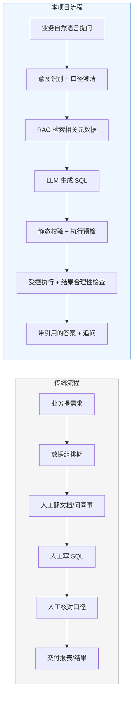

### 1.4 什么是元数据？

> **来源标注**：原始草稿

**用来描述数据的数据**。数据库的元数据包含哪些？写一条 SQL 你需要知道哪些信息？

以"给我查询第二季度的销售额 GMV"为例：

| 类别 | 需要知道什么 |
|---|---|
| 数据库 | 数据库名称、连接方式 |
| 表 | 表名、表的描述、表的类型（事实表 / 维度表） |
| 字段 | 字段名称、类型、字段描述、角色（主键/外键/度量值/维度值）、示例值 |
| 表关系 | 主外键、join 路径 |
| 指标 | GMV 的口径定义、需要哪些字段参与计算、统计粒度、时间口径 |
| 业务术语 | 行业黑话、同义词（"成交" = "支付成功" = `pay_amount`） |

> **结论**：元数据梳理是**项目最大的时间成本**，没有捷径。检索方案再精巧，也救不了
> "字段注释只写了『金额』"这种烂元数据。`【检索】` 有实证：注释写成
> "实付金额，已减去优惠与退款"，模型才能把"销售额"链到正确字段；只写"金额"必然链错。

### 1.5 目标与非目标

| 类型 | 内容 |
|---|---|
| **目标** | 高频、只读、聚合类查询的自助化（趋势、Top N、同比环比、分组汇总） |
| **非目标（一期）** | 写操作、跨库联邦查询、超长尾问题、需要人类业务判断的口径争议 |
| **非目标（长期）** | 追求"任何问题都能答"——`【检索】` 真实仓库上 top 系统也就 30–60% |

---

## 2. 问题定义：为什么难

### 2.1 为什么不能把元数据全给模型？

> **来源标注**：原始草稿

| 问题 | 说明 |
|---|---|
| token 超长 | 上百张表的 DDL 全塞进去，几十万 token，成本和延迟都不可接受 |
| 干扰严重 | 无关表的字段名会误导模型（"voltage_level" vs "rated_voltage" 这类近义字段） |
| 执行速度慢 | prefill 时间随上下文平方增长 |

`【检索】` 佐证：**"更多文档反而更糟"** 是真实现象——把整个 schema 塞进 Prompt
不仅没提高准确率，还因为近义字段干扰而下降。

### 2.2 基准分数与真实库之间的"悬崖"

> **来源标注**：联网检索资料（2026-10-21）

| 基准 | 规模 | 最佳成绩 | 人类基线 | 说明 |
|---|---|---|---|---|
| Spider 1.0 | 10,181 题 / 200 库 | 91.2%（GPT-4 系） | — | 单表、几个 join、教科书式干净 |
| BIRD | 12,751 题 / 95 库 / 37 域 / 33.4GB | 约 80–82%（2026-08 榜单最强组合系统） | 92.96% | 值是脏的、命名不一致、业务逻辑藏在列的用法里 |
| Spider 2.0（ICLR 2025） | 632 个真实企业任务 / BigQuery+Snowflake / 单库常超 1000 列 | 21.3%（o1-preview 智能体框架）；GPT-4o 10.1% | — | 需要多步 SQL，可超 100 行 |

> **换算到本项目**：Spider 1.0 的 91% 不可信；**Spider 2.0 / 真实仓库的 20–40% 才是有效信号**。
> 如果 schema 上千列、跨库、要 join、指标口径没定义，落地准确率应按 30–60% 预期。

### 2.3 难点排序

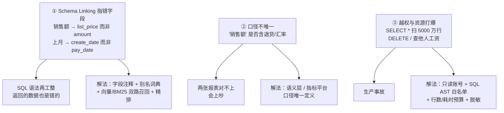

`【检索】` 关键数据：单表查询准确率可达 85–90%，**一旦涉及多表 JOIN 就跌到 60–70%**。
公开评测也显示：**Schema Linking 准确率下降，会导致最终 SQL 执行准确率更大幅度地下降**。

---

## 3. 整体架构

### 3.1 分层架构图

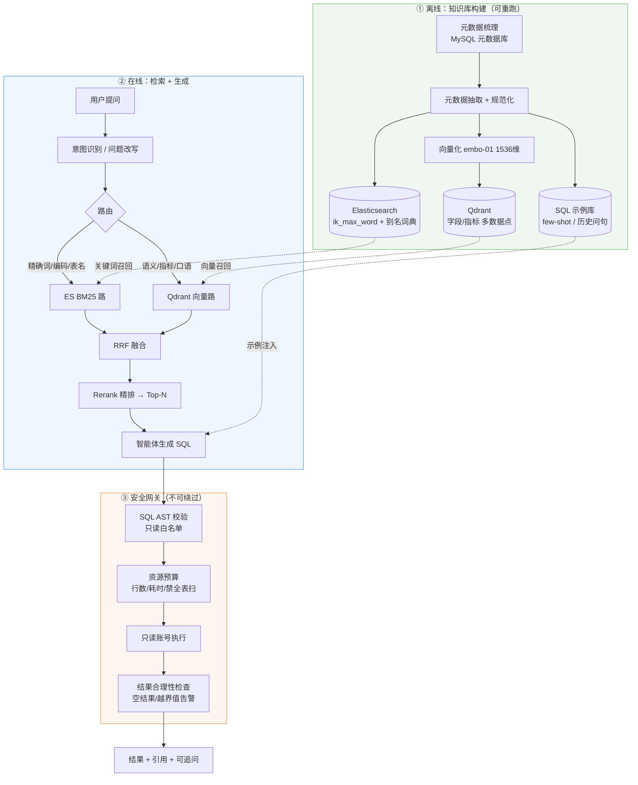

### 3.2 业界的四条路线，本项目选哪条？

> **来源标注**：联网检索资料（2026-10-21）

| 路线 | 代表 | 思路 | 优点 | 缺点 |
|---|---|---|---|---|
| ① 预置宽表 + NL2SQL | 字节 Data Agent、蚂蚁 Agentar SQL | 先把星型/雪花模型"拍平"成宽表，再在宽表上做 NL2SQL | 上线快、准确率天花板高（城商行试点 30% → 92%+） | 宽表要人建人维护，新增指标得改表 |
| ② ChatBI 升级 | 帆软 FineChatBI、Quick BI 智能小Q | 在现有 BI 上叠加对话层 | 与报表体系无缝衔接 | 受限于报表粒度，超出覆盖范围就答不了 |
| ③ 预制指标平台 | 京东指标平台、dbt 语义层 | 先定义指标口径，再让模型映射 | 口径唯一、可审计 | 前期建设重，未建模问题直接"我不知道" |
| ④ Agentic Text2SQL | 各类 Text2SqlAgent | 给模型工具，运行时自己探索库结构 | 灵活、能处理未建模问题 | 延迟高、不可控、成本高 |

**本项目定位**：走 **③ 为主 + ④ 兜底** 的组合。

- 用「指标 + 字段元数据」把口径收敛（③）
- 用「检索 + 发现式回退」处理长尾（④）
- 参考实现：LitE-SQL 走轻量路线（Schema 嵌入存向量库，参数只有大模型方案的 1/2–1/30，BIRD 准确率 72.10%）`【检索】`

### 3.3 进阶形态：NL2Semantic2SQL

> **来源标注**：联网检索资料（2026-10-21）

现在越来越多的观点认为 **NL2SQL 不是终点，语义层才是破局关键**：

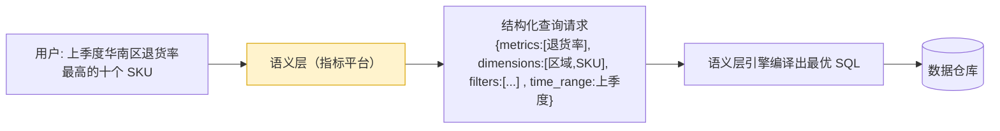

语义层的模型要素（可作为本项目指标表的字段设计参考）：

- 两大基础要素：**度量（Metric）**、**维度（Dimension）**
- 四大组合要素：**基础度量 + 业务限定 + 时间限定 + 衍生方式**
- 必须满足：统一业务语义抽象层、指标定义唯一/透明/可追溯

**没有语义层时的四类典型失败** `【检索】`：

| 失败类型 | 表现 |
|---|---|
| 歧义名词 | 模型猜错表（"客户" 指哪张表？） |
| 粒度错误 | 按天汇总月度量，数字直接错一个量级 |
| 口径漂移 | 同一指标不同人不同算法 |
| Schema 改名 | Prompt 里的表名失效，SQL 直接报错 |

**落地建议**：本项目至少要做到「**指标口径唯一定义**」这一层——即第 4 章指标表的设计要往语义层靠。

---

## 4. 离线：知识库构建

### 4.1 元数据模型（MySQL 事实源）增强

> **来源标注**：原始草稿 · 联网检索资料（2026-10-21）

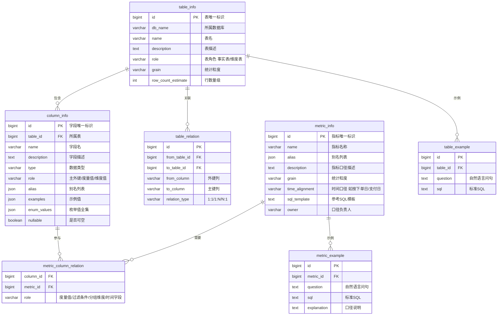

**相比原笔记新增的字段及其理由**：

| 新增 | 理由 |
|---|---|
| `table_info.grain` / `metric_info.grain` | 防"按天汇总月度量"的粒度错误 `【检索】` |
| `metric_info.time_alignment` | 下单日 vs 支付日 vs 发货日 —— 季度口径的常见翻车点 `【检索】` |
| `metric_info.owner` | 口径争议时有人可问；口径可审计 |
| `column_info.enum_values` | 状态码类字段（status=1 表示什么）必须给全，否则模型只能猜 `【检索】` |
| `column_info.nullable` | 影响 WHERE 条件与 JOIN 语义 |
| `metric_info.sql_template` | 指标的标准实现，模型照抄比自由发挥稳 |
| `table_info.row_count_estimate` | 支撑资源预算判断（这表能全扫吗） |
| `metric_example` / `table_example` | few-shot 示例库，见 [4.8](#48-示例库few-shot沉淀) |

### 4.2 采集与入仓流程

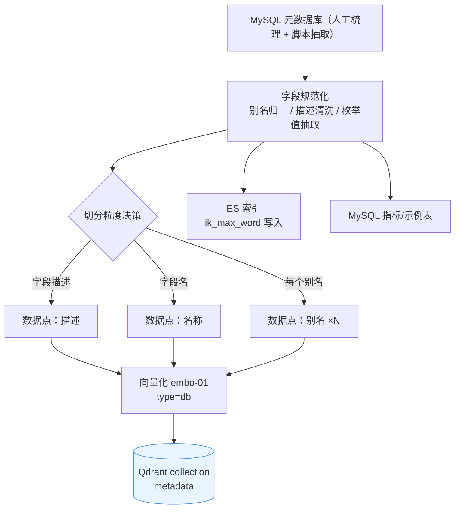

### 4.3 向量数据点怎么存？ 核心问题 1

> **来源标注**：原始草稿

**一个字段应该存成几个向量数据点？**

以字段 `pay_amount`（订单实付金额，别名：成交金额、订单金额、销售金额）为例：

| 数据点 | 文本内容 | 向量语义 |
|---|---|---|
| 1 | `订单成交金额`（字段描述） | 描述语义 |
| 2 | `pay_amount`（字段名） | 名称语义 |
| 3 | `成交金额`（别名 1） | 业务口语语义 |
| 4 | `订单金额`（别名 2） | 业务口语语义 |
| 5 | `销售金额`（别名 3） | 业务口语语义 |

**结论**：字段描述存 1 个，名称存 1 个，**有几个别名就存几个**；**所有数据点的 payload 指向同一份字段元数据**。

**关键陷阱** `【原笔记】`：

> **数据点的 id 不能直接用字段 id，否则数据点会被互相覆盖。**

正确做法是 `<字段id>:<数据点类型>:<序号>`，例如：

```
pay_amount:desc:0
pay_amount:name:0
pay_amount:alias:0
pay_amount:alias:1
pay_amount:alias:2
```

### 4.4 payload 存全量还是只存 id？ 核心问题 2

> **来源标注**：原始草稿

| 方案 | 优点 | 缺点 | 建议 |
|---|---|---|---|
| **A. 存完整字段信息** | 一次召回即可直接拼 Prompt，无需回查 MySQL，性能高 | MySQL 与 Qdrant 可能数据不一致 | ✅ **推荐**（离线写入 + 定期一致性校验） |
| **B. 只存字段 id** | 天然一致，字段频繁修改时不会过期 | 每次召回要多查一次 MySQL，链路更长 | 字段变更频繁时用 |

**折中做法**：payload 存完整字段信息用于拼 Prompt，**同时**存 `table_id` / `column_id` 用于回查校验；
一致性用定时任务比对（字段变更频率高的表走方案 B）。

### 4.5 Qdrant 集合与索引设计

> **来源标注**：联网检索资料（2026-10-21）

| 项 | 建议 | 依据 |
|---|---|---|
| 命名向量 | 描述 / 名称 / 别名可以各用一个 named vector，检索时并行 `prefetch` | Qdrant v1.10+ 支持多命名向量 |
| 稀疏向量 | 同一集合里加 `sparse` 向量（BM25 模型）做混合检索 | Qdrant 原生支持 dense+sparse 融合 |
| Payload 索引 | **入库前**就给 `table_id`、`role`、`db_name` 建 payload index | 官方生产清单：先建 payload 索引再灌数据；HNSW 只有在 payload 索引之后生成才能正确优化过滤 |
| 距离 | Cosine | 与 `embo-01` 归一化向量配合良好 |
| 召回量 | 每路 Top 50 → RRF 融合后 Top 30 → Rerank → Top 5 给模型 | 控延迟的关键：别把 200 条都送进 Rerank |

### 4.6 ES 全文检索设计

> **来源标注**：原始草稿 · 联网检索资料（2026-10-21）

**为什么用 ES 做全文检索？** 因为关键词检索是向量检索的短板：
专有名词、编码（订单号、SKU、`area_name`）、错误码，靠语义相似度经常匹配不准。

**分词策略（IK）**：

| 模式 | 用途 | 示例（"中华人民共和国人民大会堂"） |
|---|---|---|
| `ik_max_word` | **写入时**用（最细粒度） | 中华人民共和国、中华人民、中华、华人、人民共和国、人民大会堂… |
| `ik_smart` | **查询时**用（最粗粒度） | 中华人民共和国、人民大会堂 |

> 原笔记结论正确：**最细粒度拆分用于数据入库，最粗粒度拆分用于检索查询**。

**必须补充的两件事** `【检索】`：

1. **别名词典 + 行业自定义词库**：BM25 召回上限取决于分词质量。
   业务术语（"微服务网关"被切成"微/服务/网/关"）精准匹配优势直接消失。
   → ES 定期同步自定义业务词库（IK Dynamic Vocabulary）。
   → **加同义词/别名表的收益，往往超过换检索算法**。
2. **字段权重分层**：标题/字段名权重高于描述，代码段权重高于注释。

**中文分词 vs bigram 的取舍** `【检索]`：分词（jieba/IK）效果依赖分词质量但索引小；
字级/二元切分不依赖分词、召回稳但索引膨胀噪声大；**混合：同时建两套索引，两路召回后融合**。

### 4.7 别名与口语映射（决定 linking 准确率的关键）

| 用户可能说 | 应链到 |
|---|---|
| 销售额 / GMV / 成交额 | `pay_amount`（实付金额）——**不是** `list_price`（标价）`【检索】` |
| 上个月 | `pay_date`（支付日）——**不是** `create_date`（下单日）`【检索】` |
| 客户数 | `customer_id` 去重计数，还是 `users` 表行数？→ 靠指标定义消歧 |
| 退货率 | 需要 metric 支撑：退货单数 / 支付单数 |

> **这是"指标表"存在的根本原因**：当"销售额"有多个可能列时，
> 只有带着口径定义的指标能把它们区分开。`【检索】`

### 4.8 示例库（few-shot）沉淀

> **来源标注**：联网检索资料（2026-10-21）

不要只存字段，**还要存历史问句 → SQL → 口径解释**：

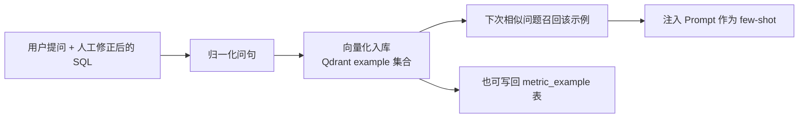

`【检索】` 实测结论：**召回到历史案例比从零开始写 SQL 效果几乎必然更好**。
指标型（metric）与表型（table）示例分开存，命中率更高。

---

## 5. 在线：检索层

### 5.1 整体检索流程

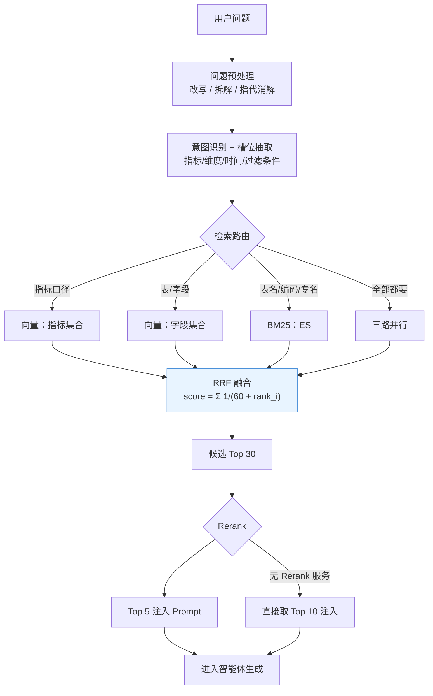

### 5.2 多路召回 + RRF 融合

> **来源标注**：联网检索资料（2026-10-21）

**为什么用 RRF 而不是加权求和？**

- 加权求和的问题：两路分数量纲完全不同（余弦相似度 0–1，BM25 无上界且随查询变化）；
  Min-Max 归一化对异常值敏感，z-score 依赖分布假设，权重 α 需要反复调、换数据集就要重调。
- **RRF 只看排名、不看分数**：`score(d) = Σ_i 1 / (k + rank_i(d))`，k 常取 60。
  天然可比、对分数分布鲁棒、调参成本低 → **默认首选**。
  只有在有明确业务信号（某场景就是关键词更重要）时才考虑加权融合。

**ES 8.x 原生 RRF**：

```json
POST /metadata/_search
{
  "retriever": {
    "rrf": {
      "retrievers": [
        {
          "standard": {
            "query": {
              "match": {
                "content": { "query": "第二季度 GMV", "analyzer": "ik_smart" }
              }
            }
          }
        },
        {
          "knn": {
            "field": "content_vector",
            "query_vector": [0.12, -0.34, "..."],
            "k": 20,
            "num_candidates": 100
          }
        }
      ],
      "rank_constant": 60,
      "rank_window_size": 50
    }
  },
  "size": 10
}
```

> ES 8.x 起支持 RRF 组合 BM25 与 dense_vector（HNSW）；8.16+ 推荐用 `retriever.rrf` 语法，
> 更早版本用顶层 `rrf` 查询。

**Qdrant 一次请求多路检索**：

```python
from qdrant_client import QdrantClient, models

client = QdrantClient(url="http://localhost:6333")

res = client.query_points(
    collection_name="metadata",
    prefetch=[
        models.Prefetch(query=qdrant_vec, using="desc", limit=50,
                        filter=must_not_see_hidden),
        models.Prefetch(query=models.SparseVector(indices=idx, values=val),
                        using="sparse", limit=50),
    ],
    query=models.FusionQuery(fusion=models.Fusion.RRF),
    limit=30,
    with_payload=True,
)
```

`【检索】` 效果量级（50 万文档 / 500 条测试集）：

| 方案 | Hit@5 | MRR@5 | P95 延迟 |
|---|---|---|---|
| 纯向量 | 68.4% | 0.52 | 22ms |
| BM25 + 向量（RRF） | 82.1% | 0.69 | 35ms |
| BM25 + 向量 + Cross-Encoder Rerank | **94.6%** | **0.88** | 78ms |

→ **混合检索比纯向量召回准确率高 10–20 个百分点**，加 Rerank 再提升约 12 个点。

### 5.3 重排（Rerank）

`【检索】` 要点：

- 召回 TopK 后**不能直接塞给大模型**——10 段里 9 段不相关，模型仍会被带偏。
- 两种做法：**Rerank 模型逐条打分**（性能好，适合在线链路）/ **大模型自己精排**（准确率高，适合离线质检）。
- 典型工程参数：每路召回 50 → RRF 融合 → 截 Top 30 → Rerank → 保留 Top 5，
  把 Rerank 延迟严格控制在 **30–80ms**。

> ⚠️ **本项目的现实约束**：实测 MiniMax 的 `/v1/rerank` 端点在
> `api.minimaxi.com` 与 `api.minimax.io` 均返回 404 `【实测】`。
> → 备选方案：① 商用 Rerank API（BGE-Reranker / Cohere 等）② 自部署 bge-reranker
> ③ **大模型精排**（用 M3 对 Top 30 打相关性分，作为一期的兜底）。

### 5.4 多阶段检索

> **来源标注**：联网检索资料（2026-10-21）

不要一次把整个 schema 捞出来，**分阶段扩展**：

1. 第一阶段：检索直接相关的**表**
2. 第二阶段：根据表结果检索**间接关联表**（主外键扩展）
3. 第三阶段：检索**字段**与**指标**
4. 逐步扩展检索范围，直至覆盖所有必要表

### 5.5 延迟预算

| 阶段 | 预算 | 优化手段 |
|---|---|---|
| 意图识别 | 100ms | 小模型 / 规则 + 缓存 |
| 检索（向量 + BM25 并行） | 50ms | Qdrant HNSW + ES filter cache |
| RRF 融合 | ~0 | 纯内存计算 |
| Rerank | 30–80ms | 限制候选数 Top 30 |
| LLM 生成 | 3–15s | Prompt 缓存（M3 支持 prompt caching）|
| SQL 执行 | < 5s | 行数/耗时预算，超限降级为"预估" |

**工程手段** `【检索】`：高频查询的**检索结果缓存**（如 1 小时 TTL）；
**异步检索**——用户还在打字时提前触发检索，确认意图后直接用结果。

### 5.6 检索层的失效模式

| 失效 | 症状 | 对策 |
|---|---|---|
| 召回不足 | 该用的表没进候选 | 提高向量路召回量、加别名词典、BM25 兜底 |
| 召回了但排不上 | 正确字段在 Top 50 外 | Rerank；提高 query 改写质量 |
| 干扰召回 | 近义字段挤占名额 | 字段注释写清差异 + 冲突消解（向量+BM25 交叉验证）|
| 粒度漂移 | 汇总维度错 | 指标表带 `grain`；Prompt 显式声明 |
| 指标未覆盖 | 用户问的指标库里没有 | **发现式回退**：让 Agent 探索库结构后明确告知"该口径未定义" |

---

## 6. 在线：智能体（LangGraph）

### 6.1 状态图

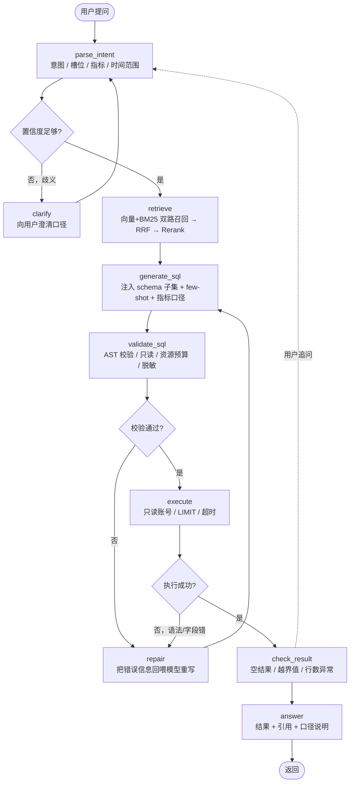

### 6.2 State 设计

> **来源标注**：联网检索资料（2026-10-21）

State 里的字段**不要贪多**——每轮都会被多个节点读写，字段多会拖慢执行、造成内存膨胀。
按生命周期分三类：

| 类别 | 内容 | 例子 |
|---|---|---|
| 短期会话数据 | 当前对话消息 | `messages` |
| 中期流程数据 | 已调用过的工具、已召回的 schema | `retrieved_schema`、`tool_calls` |
| 长期业务数据 | **只放引用，不放全文** | `user_id`、`order_no` |

用 `TypedDict` 明确定义；字段应 JSON 可序列化以便持久化（checkpointer）。

```python
from typing import Annotated, TypedDict
from langgraph.graph.message import add_messages

class Text2SQLState(TypedDict):
    messages: Annotated[list, add_messages]        # 短期
    intent: str | None                              # 中期
    slots: dict                                     # 中期
    retrieved_schema: list[dict]                    # 中期
    sql: str | None                                 # 中期
    sql_error: str | None                           # 中期
    result_preview: list[dict] | None               # 中期
    user_id: str                                    # 长期（引用）
    iteration: int                                  # 计数器（防死循环）
```

### 6.3 工具清单

| 工具 | 作用 | 约束 |
|---|---|---|
| `search_metadata(query, type)` | 检索表/字段/指标 | 只读，限制返回条数 |
| `get_table_schema(table_id)` | 取完整表结构 | 单表限定 |
| `get_metric_definition(metric_id)` | 取指标口径 | 返回口径文本 + 参考 SQL |
| `list_indexes(table_id)` | 取索引/主外键 | 用于 JOIN 路径推断 |
| `run_sql(sql, limit, timeout)` | 受控执行 | **只读账号 + AST 白名单 + LIMIT + 超时** |
| `explain(sql)` | 看执行计划 | 预检全表扫 |
| `get_sample_values(column_id)` | 取枚举值 | 小样本，不泄露敏感值 |

`【检索】` 工具设计原则：**幂等、尽量无副作用**；有副作用的工具（发消息、下单）
要在状态里标记已执行或实现去重；工具函数必须**捕获异常并返回可读的错误信息**，
而不是把 traceback 抛给模型。

### 6.4 反思修正回路

> **来源标注**：联网检索资料（2026-10-21）

`Dynamic-SQL` 框架的组合拳 `【检索】`：

1. 混合向量检索 + LLM 引导的 schema linking
2. 真实值（real-value）与 few-shot 示例增强
3. 多路径 CoT 融合推理
4. **执行驱动的多轮自纠错**

→ 在 BIRD 上用 qwen2.5-coder-32b-instruct 达到 63.23% 执行准确率。
→ `ZSS-Linker`（零样本 schema linker）把"表名/字段名/枚举值"转成自然语言描述做对比学习，
   **字段检索准确率 81.3%（召回率 99.2%），端到端执行准确率 78.6%**，比无微调基线高 15–20 个点。
   **这直接验证了本项目"元数据转自然语言 + 向量召回"路线的有效性。**

### 6.5 终止条件与防死循环

> **来源标注**：联网检索资料（2026-10-21）

LangGraph 报 `RecursionError` / recursion limit 时，**先查为什么循环**，
不要急着调大数字。常见原因：

- 工具返回结果为空，模型无法据此生成最终回答
- 模型始终认为需要调工具，但工具结果没解决问题
- 工具本身有副作用，每次返回不同结果，导致无法收敛

对策：State 里加计数器 `iteration`，超阈值走"失败反馈"分支；
工具返回要**收敛信息**（明确说"没找到"而不是空数组）。

---

## 7. 安全与治理（必须前置）

### 7.1 真实拦截案例

> **来源标注**：联网检索资料（2026-10-21）

某 Text2SQL 系统上线第一个月拦下的真实请求 —— **每一条都是合法 SQL，每一条都不该执行**：

| 用户说 | 模型生成 | 为什么该拦 |
|---|---|---|
| "给我看所有数据" | `SELECT *` 扫一张 5000 万行的表 | 资源打爆 |
| "把测试记录删了" | `DELETE` | 写操作 |
| "管理员密码是什么" | 真的去查 `users` 表 | 敏感字段 |
| "我想看同事绩效" | 把别人的工资列出来了 | 越权 |

> 模型懂语法，**但它不懂授权、资源预算和业务规则**。这三样只能靠工程补。

### 7.2 校验链

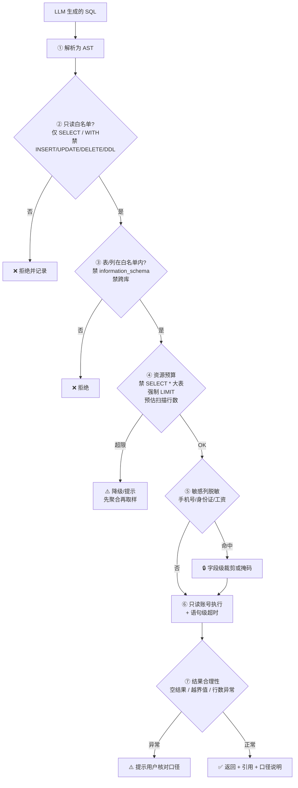

### 7.3 治理清单

| 类别 | 措施 |
|---|---|
| **账号** | 独立只读账号；按业务线分库分账号；无 DDL/DML 权限 |
| **语句** | AST 白名单解析；强制 LIMIT；禁 `SELECT *` 于大表；禁多语句；禁注释绕过 |
| **资源** | 语句超时（秒级）；连接池隔离；并发上限；慢查询熔断 |
| **数据** | 敏感列字典 + 自动脱敏；行级权限（按 user_id 过滤，注入 WHERE 条件）|
| **语义** | 指标口径唯一；冲突口径告警；不可解释的结果不展示 |
| **审计** | 全量记录 (用户, 问题, 召回内容, SQL, 耗时, 行数, 结果摘要)；异常请求单独告警 |
| **交互** | 高风险操作走人工确认（human-in-the-loop）`【检索】` |

---

## 8. 评估与迭代

### 8.1 评估指标

> **来源标注**：联网检索资料（2026-10-21）

| 指标 | 说明 | 本项目目标 |
|---|---|---|
| **执行准确率 EX** | 把生成的 SQL 跑在真实库上，比对返回行（**不是 exact match**） | 主指标 |
| 语义匹配度 | SQL 意图与用户问题一致（人工标注或 BERTScore） | 辅助 |
| Schema Linking 准确率 | 字段召回是否正确、是否指错 | 分环节指标 |
| 端到端延迟 | 平均响应时间、检索模块耗时占比 | 性能 |
| 拒答准确率 | 该说"我不确定"时是否说了 | 安全性 |

> **主指标必须是 EX**：文本完全匹配会因为列顺序、等价写法而误判。
> 官方工具：Defog `sql-eval`、Inspect AI、OpenAI cookbook（Vanna 已归档）。

### 8.2 分环节评估（定位问题出在哪一环）

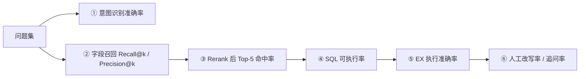

`【检索】` 公开评测显示：**Schema Linking 准确率下降会导致最终执行准确率更大幅度下降**，
所以必须分环节看，不能只看端到端。

### 8.3 反馈闭环


---

## 9. 技术选型速查

### 9.1 组件表

| 层 | 选型 | 说明 |
|---|---|---|
| LLM | **MiniMax-M3**（多模态、1M 上下文、支持工具调用、SWE-Bench Pro 59）| 主生成模型；M2.7 / M2.7-highspeed 做低成本档 `【检索】` |
| LLM 备用 | MiniMax-M2.5 / M2.1 | 高并发、成本敏感场景 |
| Embedding | **MiniMax `embo-01`（1536 维）** | 已实测可用 `【实测】` |
| 向量库 | **Qdrant** | 多命名向量、prefetch + RRF、payload index `【检索】` |
| 全文检索 | **Elasticsearch 8.x + IK** | 原生 RRF；中文分词需自定义词库 `【检索】` |
| 元数据库 | **MySQL** | 元数据事实源 |
| 语义层（可选） | dbt Semantic Layer / Cube.js / MCP | 指标口径统一 `【检索】` |
| 编排 | **LangGraph** | 状态图、checkpoint、human-in-the-loop `【检索】` |
| 观测 | LangSmith | trace / 评测 `【检索】` |
| 工具桥接 | MCP（可选） | 语义层以 MCP 暴露 `list_metrics` / `get_dimensions` / `query_metrics` / `get_metrics_compiled_sql` `【检索】` |

### 9.2 MiniMax 接口实测结论 （2026-10-21，region=cn）

> **来源标注**：本机实测

| 能力 | 端点 | 结论 |
|---|---|---|
| 模型列表 | `GET https://api.minimaxi.com/v1/models` | ✅ `MiniMax-M3 / M3.1-Flash / M2.7 / M2.7-highspeed / M2.5 / M2.1 / M2` |
| 对话 | `POST /v1/chat/completions` | ✅ OpenAI 兼容 |
| Embedding | `POST /v1/embeddings` | ✅ 模型 `embo-01`，**维度 1536**；参数是 **`texts`**（不是 `input`）+ **`type`**(`db` 入库 / `query` 检索)；返回 `{"vectors":[[...]]}` |
| Rerank | `/v1/rerank` | ❌ `api.minimaxi.com` 与 `api.minimax.io` 均 404 |
| Anthropic 兼容 | `api.minimax.io/anthropic/v1/messages` | ⚠️ 端点存在，但 CN 区域 key 返回 401（key 绑区域）|
| CLI 行为 | `mmx text chat --quiet --output json` | ⚠️ 会退化成纯文本（丢 JSON 外壳）；其他命令仍输出 JSON。**要完整响应体就别加 `--quiet`** |

> 完整实测记录见 [demo_out/README.md](demo_out/README.md)。

### 9.3 关键代码骨架

**LangChain 接入 MiniMax（OpenAI 兼容）**：

```python
import os
from langchain_openai import ChatOpenAI

def get_llm(model: str = "MiniMax-M3", temperature: float = 0.0) -> ChatOpenAI:
    return ChatOpenAI(
        base_url=os.getenv("MINIMAX_BASE_URL", "https://api.minimaxi.com/v1"),  # global: https://api.minimax.io/v1
        api_key=os.environ["MINIMAX_API_KEY"],
        model=model,
        temperature=temperature,
        timeout=120,
        max_retries=2,
    )
```

**自定义 Embeddings（注意 `texts` 与 `type`）**：

```python
import os
import requests
from langchain_core.embeddings import Embeddings

class MiniMaxEmbeddings(Embeddings):
    """MiniMax embo-01 封装。
    注意：参数名是 texts 而不是 input，且必须带 type（db=入库, query=检索）。"""
    dim: int = 1536

    def __init__(self, model: str = "embo-01", base_url: str | None = None,
                 api_key: str | None = None):
        self.model = model
        self.base_url = (base_url or os.getenv("MINIMAX_BASE_URL")
                         or "https://api.minimaxi.com/v1").rstrip("/")
        self.api_key = api_key or os.environ["MINIMAX_API_KEY"]

    def _embed(self, texts: list[str], type_: str) -> list[list[float]]:
        resp = requests.post(
            f"{self.base_url}/embeddings",
            headers={"Authorization": f"Bearer {self.api_key}"},
            json={"model": self.model, "texts": texts, "type": type_},
            timeout=60,
        )
        resp.raise_for_status()
        return resp.json()["vectors"]

    def embed_documents(self, texts: list[str]) -> list[list[float]]:
        return self._embed(texts, "db")

    def embed_query(self, text: str) -> list[float]:
        return self._embed([text], "query")[0]
```

**Qdrant 写入（一个字段多个数据点，id 不能冲突）**：

```python
from qdrant_client import QdrantClient, models

client = QdrantClient(url="http://localhost:6333")
client.create_collection(
    collection_name="metadata",
    vectors_config={
        "desc": models.VectorParams(size=1536, distance=models.Distance.COSINE),
        "name": models.VectorParams(size=1536, distance=models.Distance.COSINE),
    },
)

def upsert_column(col: dict, embedder: MiniMaxEmbeddings) -> None:
    points = [
        ("desc", f"{col['table_name']}.{col['name']}", col["description"]),
        ("name", f"{col['table_name']}.{col['name']}", col["name"]),
    ] + [
        ("name", f"{col['table_name']}.{col['name']}", a) for a in col.get("alias", [])
    ]
    client.upsert(
        collection_name="metadata",
        points=[
            models.PointStruct(
                id=f"{col['id']}:{kind}:{i}",            # ← 关键：id 带上类型与序号，避免覆盖
                vector={kind: embedder.embed_query(text)},  # 逐条嵌入，注意批量接口用 embed_documents
                payload={"column_id": col["id"], "table_id": col["table_id"],
                         "role": col["role"], "kind": kind, "full": col},
            )
            for i, (kind, pid, text) in enumerate(points)
        ],
    )
```

**检索（双路 + RRF）**：

```python
res = client.query_points(
    collection_name="metadata",
    prefetch=[
        models.Prefetch(query=q_vec, using="desc", limit=50),
        models.Prefetch(query=q_vec, using="name", limit=50),
    ],
    query=models.FusionQuery(fusion=models.Fusion.RRF),
    limit=30,
    with_payload=True,
)
```

**SQL AST 安全校验（骨架）**：

```python
import sqlglot
from sqlglot import exp

READ_ONLY = (exp.Select, exp.Union, exp.Subquery, exp.With)

def validate_sql(sql: str, allowed_tables: set[str], max_rows: int = 1000) -> str:
    tree = sqlglot.parse_one(sql, read="mysql")
    if not isinstance(tree, READ_ONLY):
        raise ValueError("只允许 SELECT 类语句")
    tables = {t.name for t in tree.find_all(exp.Table)}
    if not tables <= allowed_tables:
        raise ValueError(f"越权访问表: {tables - allowed_tables}")
    tree = tree.limit(max_rows)            # 强制 LIMIT
    if "*" in {e.name for e in tree.find_all(exp.Column)}:
        raise ValueError("禁止 SELECT *")
    return tree.sql(dialect="mysql")
```

---

## 10. 落地路线图与待办

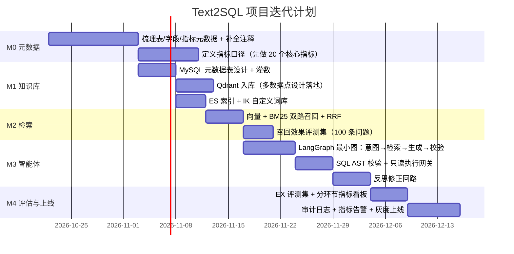

### TODO 清单

- [ ] **M0** 选 1 个业务域（建议从"销售/订单"这类字段少、口径清晰的域起步）作为试点
- [ ] **M0** 所有字段注释改成"**实付金额，已减去优惠与退款**"这种可判定的写法，而不是"金额"
- [ ] **M0** 每个指标明确：**口径 / 粒度 / 时间口径 / 负责人 / 参考 SQL**
- [ ] **M1** Qdrant 用**命名向量**分 `desc` / `name`；payload 索引在灌数**之前**建好
- [ ] **M1** ES 建 IK 自定义词库（业务术语 + 别名），写入用 `ik_max_word`、查询用 `ik_smart`
- [ ] **M2** 先用「大模型精排」顶替缺失的 Rerank 服务，接口留好替换点
- [ ] **M3** State 用 `TypedDict`，大对象只存引用；加 `iteration` 计数器
- [ ] **M3** 工具全部"幂等 + 捕获异常 + 返回可读错误"
- [ ] **M4** 评测以 **EX** 为主指标，分环节埋点（意图 / 召回 / 重排 / 可执行 / EX）
- [ ] **M4** 审计日志字段：用户、问题、召回内容、SQL、耗时、行数、结果摘要

---

## 11. 参考资料

以下为 2026-10-21 通过 `mmx search query` 检索到的公开资料（标题 + 链接）：

**Text2SQL 现状与评估**
- [Text2SQL 工程：让 Agent 安全地查你的数据库](https://m.toutiao.com/article/7685918771937722895) — 线上事故清单、Spider/BIRD 悬崖
- [The Text-to-SQL Accuracy Cliff: Why Deterministic Compilers Beat LLM Guessing](https://www.colrows.com/blogs/text-to-sql-accuracy-cliff) — Spider 2.0 数据
- [The Text-to-SQL Cliff: 91% on Spider, 21% on Real Schemas](https://veraexmachina.com/tech/text-to-sql-enterprise-cliff-2026)
- [Text-to-SQL Accuracy in 2026: Why the Benchmark Says 90% and Your Warehouse Says 40%](https://dreaming.press/posts/text-to-sql-accuracy-spider-vs-bird.html)
- [Text-to-SQL LLM Leaderboard 2026](https://awesomeagents.ai/leaderboards/text-to-sql-leaderboard) · [Benchmark: Accuracy and Latency (2026)](https://iotdigitaltwinplm.com/?p=6176/)
- [Text-to-SQL AI Evals](https://www.aievals.co/learn/task-types/text-to-sql) — EX 指标与评测工具
- [Improving NL2SQL Accuracy in Enterprise Deployments](https://www.beehivestrategy.com/blog/articles/nl2sql-accuracy-improvement-enterprise-oct2025)

**Schema Linking 与元数据**
- [Schema Linking：NL2SQL 怎么知道数据对应哪张表](https://m.toutiao.com/article/7688272375476945423) — 错链案例、注释质量
- [NL2SQL 在工业级场景下的精度优化：Schema Linking + 动态 Few-shot](https://blog.csdn.net/circuitsosk/article/details/164096991) — 单表 85–90% / 多表 60–70%
- [Rethinking Schema Linking: A Context-Aware Bidirectional Retrieval Approach](http://ar5iv.labs.arxiv.org/html/2510.14296) · [ZSS-Linker（零样本 schema linker）](https://blog.csdn.net/coreopt/article/details/162313064)
- [Ontology-Driven NL2SQL: Semantic Governance Is the Real Prize](https://www.besthub.dev/articles/ontology-driven-nl2sql-semantic-governance-is-the-real-prize-not-accuracy-2539ff1aae8e)
- [Dynamic-SQL: adaptive NL2SQL with multi-path fusion reasoning and execution feedback](https://link.springer.com/10.1038/s41598-026-47693-2)

**语义层 / 指标平台**
- [解构智能问数：为什么 NL2SQL 不是终点，语义层才是破局关键](https://k.sina.cn/article_1746173800_68147f6801901d0ta.html)
- [从"写SQL"到"聊数据"：NL2SQL 如何用自然语言解锁数据库](https://blog.csdn.net/qq_35485206/article/details/150458388) — 度量/维度 + 四大要素
- [Why Text-to-SQL Is the Wrong Layer: The Case for Text-to-Metric](https://singdata.com/trending/text-to-metric-metric-resolution)
- [Semantic layer: what it is, how it works and how to choose in 2026](https://computese.com/semantic-layer) — dbt MCP server 工具
- [Agentic Semantic Layers: MCP, Cube, dbt and Microsoft's SQL MCP Server](https://reasoncore.dev/post/agentic-semantic-layers-mcp-cube-dbt-and-microsofts-sql-mcp-server)
- [MCP 技术社区：Text-to-SQL 四条技术路线对比](https://mcp.csdn.net/6a72d74710ee7a33f296384d.html) — 蚂蚁 Agentar SQL 92%+

**检索层**
- [Qdrant 官方文档：Hybrid and Multi-Stage Queries](https://qdrant.tech/documentation/concepts/hybrid-queries/) · [生产环境检查清单](https://qdrant.tech/documentation/guides/production-checklist)
- [混合检索：向量 + BM25 + RRF + Rerank](https://blog.csdn.net/m0_59164520/article/details/167224745)
- [关于混合检索 RRF 与重排序的那些事](https://blog.51cto.com/u_16213626/14938313) — RRF vs 加权求和
- [RAG 混合检索实战：BM25 + 向量分数融合（附 RRF 解析）](https://blog.csdn.net/u014534808/article/details/160961387)
- [生产级 RAG 检索调优：BM25 + 向量混合检索与 Cross-Encoder 重排序](https://www.cnblogs.com/995i996/p/23051235) — Hit@5 68.4/82.1/94.6%
- [Elasticsearch 在 RAG 中的检索机制](https://blog.csdn.net/uybji/article/details/166141987) — IK 策略
- [BM25 检索算法：中文分词适配与 Elasticsearch 实践](https://heibaimeng.com/post/322) — RRF 查询示例
- [RAG 检索增强生成深度解读：搜索引擎、基础 RAG 与混合检索](https://blog.csdn.net/2301_80809484/article/details/164801938)
- [RAG 与 NL2SQL 混合路由：PolarDB Agent Express 架构实践](https://blog.csdn.net/weixin_33824385/article/details/165424433) — 混合检索 +10–20pp

**智能体编排**
- [LangGraph 实战：从链式调用到状态图编排 Agent](https://blog.csdn.net/weixin_32175665/article/details/164252837) — recursion limit 排错
- [LangGraph 实战：从零构建具备记忆与工具调用能力的 AI Agent](https://blog.csdn.net/weixin_29054245/article/details/163805319) — 状态设计
- [使用 LangGraph 与 LangChain 构建多工具有状态智能体](https://jimmysong.io/zh/book/ai-handbook/agent/langgraph) — 防死循环、工具幂等
- [AI agent frameworks compared in 2026](https://byteledger.vizleo.com/blog/ai-agent-frameworks-compared-2026)
- [LangGraph in 2026: Build a Support Agent That Knows When to Ask](https://www.diego-rodriguez.work/blog/langgraph-2026-support-agent-tutorial) — human-in-the-loop

**RAG 落地与工程**
- [RAG 落地关键：Text2SQL 从原理到实战](https://blog.csdn.net/uncle_ll/article/details/158067508) — DDL、few-shot、反思循环
- [LLM + RAG 实现 Text2SQL 终极指南](https://blog.csdn.net/m0_59163425/article/details/156045389)
- [RAG + Text2SQL：基于 DB-GPT 的海洋环境智能查询实践](https://finance.sina.com.cn/wm/2026-05-15/doc-inhxycci6158126.shtml) — 分类小库 + 路由
- [LLM RAG 赋能 Text2SQL：智能查询生成的架构与实践](https://cloud.baidu.com/article/5543472) — 分阶段检索、缓存
- [Text2SQL 实战：用大模型让自然语言查询数据库](https://blog.csdn.net/weixin_29219539/article/details/165169135) — 历史查询示例入库

**模型**
- [MiniMax M3 Benchmark](https://minimaxm3.com/blog/minimax-m3-benchmark) · [MiniMax M3 编程能力深度评测](https://www.cn486.com/news/4131854) · [MiniMax M3: sparse attention architecture](https://robotsatlas.com/posts/minimax-m3-nowa-architektura-sparse-attention-i-156-szybszy-dekoding)

---

## 附录 A：原笔记内容对照表

原 README.md 的每一条思考在本文件中的位置：

| 原笔记内容 | 本文件位置 | 是否增强 |
|---|---|---|
| 为什么要做（降门槛/提效率/元数据分散） | [1.1](#11-为什么要做这个项目) | ✅ 补上"Demo 半天 vs 上线 6 周" |
| 业务范围：查询类工作 | [1.2](#12-业务范围) | ✅ 补上"写操作不在一期"及理由 |
| 传统开发流程 | [1.3](#13-传统开发流程-vs-本项目流程) | ✅ 补上新流程对比图 |
| 什么是元数据 / 写 SQL 需要知道什么 | [1.4](#14-什么是元数据) | ✅ 补上枚举值、粒度、时间口径 |
| 梳理元数据是时间大头 | [1.4](#14-什么是元数据) 结论 | ✅ 补上"注释质量决定 linking 质量"实证 |
| 如何用大模型生成 SQL | [3](#3-整体架构) / [6](#6-在线智能体langgraph) | ✅ 补上四条路线与状态图 |
| 为什么不能全给模型（token/干扰/慢） | [2.1](#21-为什么不能把元数据全给模型) | ✅ 补上"更多文档反而更糟"实证 |
| 解法：知识库 + RAG 检索 | [4](#4-离线知识库构建) / [5](#5-在线检索层) | ✅ 补上 RRF/Rerank 方案与代码 |
| 知识库构建：MySQL / Qdrant / ES | [4.1](#41-元数据模型mysql-事实源增强) / [4.5](#45-qdrant-集合与索引设计) / [4.6](#46-es-全文检索设计) | ✅ 补上 payload 索引、命名向量、词库 |
| 为什么用 ES 做全文检索 | [4.6](#46-es-全文检索设计) | ✅ 补上 BM25 上限取决于分词质量 |
| IK 分词策略（最细入库/最粗查询） | [4.6](#46-es-全文检索设计) 表格 | ✅ 补上别名词典、字级 bigram 备选 |
| 元数据如何设计存储（4 张表 + 字段） | [4.1](#41-元数据模型mysql-事实源增强) ER 图 + DDL 注释 | ✅ 新增 8 个字段并说明理由 |
| 生成 SQL 需要知道什么 | [1.4](#14-什么是元数据) 表 | ✅ 合并整理 |
| 向量数据如何存储、字段拆几个数据点 | [4.3](#43-向量数据点怎么存-核心问题-1) | ✅ 补上 id 命名规范与 Qdrant 代码 |
| payload 存全量 vs 存 id 的权衡 | [4.4](#44-payload-存全量还是只存-id-核心问题-2) | ✅ 补上折中方案与校验策略 |
| 表关系（主外键）查询方式 | [4.1](#41-元数据模型mysql-事实源增强) `table_relation` | ✅ 补上 JOIN 路径推理 |
| 指标字段关系表 | [4.1](#41-元数据模型mysql-事实源增强) `metric_column_relation` | ✅ 补上角色维度 |

---

## 附录 B：术语表

| 术语 | 含义 |
|---|---|
| **Text2SQL / NL2SQL** | 自然语言转 SQL |
| **NL2Semantic2SQL** | 自然语言 → 语义查询请求 → 语义层编译出 SQL |
| **Schema Linking** | 把用户提到的业务词，链到具体的表和字段 |
| **元数据** | 描述数据的数据：表结构、字段注释、关系、指标口径 |
| **语义层 / 指标平台** | 度量 + 维度的统一抽象层，指标口径唯一定义处 |
| **RAG** | 检索增强生成：先检索再生成 |
| **混合检索** | BM25（稀疏）+ 向量（稠密）并行召回后融合 |
| **RRF** | Reciprocal Rank Fusion，只用排名不用分数的融合算法 |
| **Rerank / 重排** | 对召回候选逐条精排相关性 |
| **EX（执行准确率）** | 跑出相同结果集即算对，Text2SQL 的主指标 |
| **Hit@k / MRR** | 检索质量指标：前 k 条命中率 / 平均倒数排名 |
| **IK 分词** | ES 中文分词器：`ik_max_word`（细，写入）/ `ik_smart`（粗，查询）|
| **Payload** | Qdrant 每个点的附加 JSON 数据 |
| **Named Vector** | Qdrant 一个点里的多把命名向量（描述/名称各一把）|
| **Prefetch + Fusion** | Qdrant 一次请求多路召回并融合 |
| **宽表** | 把多表 JOIN 结果预先拍平的大表，降低 NL2SQL 难度 |
| **HNSW** | 向量近邻检索的图索引，ES/Qdrant 底层都用 |
| **few-shot 示例库** | 历史问句 → SQL → 口径说明，入库可召回 |

---

*本文档由原始草稿 + 2026-10-21 联网检索资料 + 本机 MiniMax API 实测结果整理而成。
检索内容均为公开资料，标注 `【检索】`；标注 `【实测】` 的为本机验证结论。*
